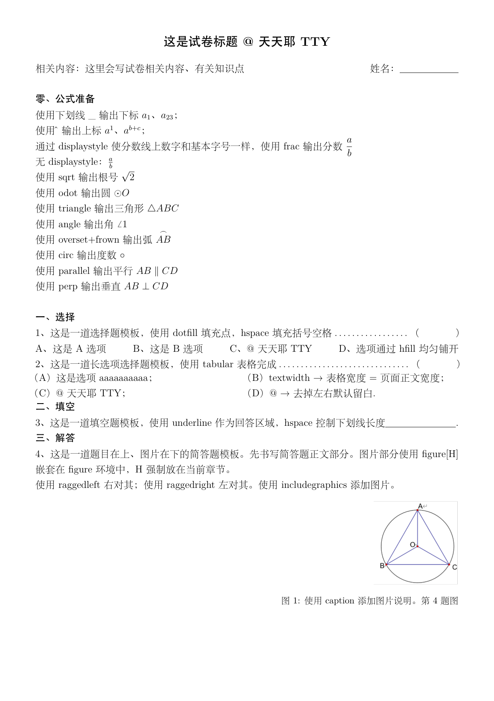

# LaTeX-Exam-Template

用 LaTeX 快速制作**试卷**的模板工程。把题目填进对应题型的现成模板，一条命令编译，就能得到一张版式规整的 A4 试卷——不用反复调排版、不用碰格式细节，专心出题即可。

> 作者：**TiantianYe**
>
> 作者在 App Store 中的其他代表作品：水课帮-课堂提问助手；识词本-单词笔记；投影与视图3D教具；解构照片

## 试卷预览



## 使用场景

适合数学等需要大量公式排版的学科：

- 期中期末考试卷、平时测验卷、课后练习卷、周周练
- 题型覆盖：**选择题**（短选项 / 长选项两种排版）、**填空题**、**解答题**（图在下 / 文左图右等三种排版）
- 版式已定好：A4 单栏、四边 1.5cm 页边距、无页码、小三号加粗标题 + 小四号正文、全局取消段首缩进
- 内置**公式准备速查区**：下标、上标、分数、根号、圆（⊙）、三角形（△）、角（∠）、弧（⌒）、度数（°）、平行（∥）、垂直（⊥），出题时照抄即可

## 环境要求

- 任意 TeX 发行版：macOS 装 [MacTeX](https://www.tug.org/mactex/)，Windows 装 TeX Live 或 MiKTeX
- 编译器必须用 **XeLaTeX**（模板基于 `ctexart` 中文文档类）

## 快速开始

1. 复制 `试卷模板.tex`，按考试名称重命名（如 `2026年期中考试.tex`）
2. 修改试卷标题和"相关内容"一行，删除姓名栏或改成班级 / 学号
3. 把题目逐题填入下方对应题型模板
4. 编译：

```bash
xelatex 你的文件名.tex
```

需要插入图片的，把图片文件和 tex 放在同一目录，编译时 `\includegraphics` 直接引用文件名即可（模板用到的占位图为 `图片模板.png`）。

## 模板结构

```text
导言区（整个 copy 即可，无需改动）
 ├─ ctexart 文档类 + amsmath / graphicx / geometry 等常用包
 ├─ 全局取消段首缩进、小四号正文、隐藏页码
 └─ 居中的小三号加粗试卷标题
正文
 ├─ 相关内容 + 姓名：＿＿＿
 ├─ 零、公式准备（速查区，出题时照抄，交付时可删）
 ├─ 一、选择：题 1（短选项）、题 2（长选项）
 ├─ 二、填空：题 3
 ├─ 三、解答：题 4（图在下）、题 5（newpage 分页）、题 6/7/8（文左图右、高度调整、FloatBarrier）
 └─ 结束
```

## 内置封装速查表

模板里已封装好的"函数"，拿来即用：

| 需求 | 写法 |
|---|---|
| 选择题答案括号前的点线 | `\dotfill（\hspace{1.5cm}）` |
| 选项一行均匀铺开（ABCD） | 选项之间用 `\hfill` 连接 |
| 填空题下划线答题区 | `\underline{\hspace{3cm}}`（改长度调 `hspace`） |
| 长选项两栏排布 | `\begin{tabular*}{\textwidth}{@{}p{0.48\textwidth} p{0.48\textwidth}@{}}` |
| 分数（字号线数字与正文同大） | `$\displaystyle\frac{a}{b}$` |
| 常用几何符号 | `$\odot O$`、`$\triangle ABC$`、`$\angle 1$`、`$\overset{\frown}{AB}$`、`$45^\circ$`、`$AB\parallel CD$`、`$AB\perp CD$` |
| 题目下方插图（强制原位） | `\begin{figure}[H]` + `\includegraphics[width=0.2\textwidth]{图片.png}` + `\caption{第 x 题图}` |
| 图注右对齐 | `\raggedleft`（左对齐用 `\raggedright`） |
| 文字在左、图片在右 | 两个 `minipage`（0.7 / 0.28 宽度）+ 中间 `\hfill` |
| 非浮动体里加图注 | `\captionof{figure}{第 x 题图}` |
| 防止图片排版串位 | `minipage` / `figure` 之后接 `\FloatBarrier` |
| 精确空行 | `\vspace*{n\baselineskip}`（n 为行数） |
| 强制换页 | `\newpage` |

## 题型模板详解

### 选择题（短选项）

题干用 `\dotfill` 把点线一直推到行尾的作答括号前；四个选项之间用 `\hfill` 均匀铺开一行：

```latex
1、题干内容\dotfill（\hspace{1.5cm}）

A、选项甲\hfill B、选项乙\hfill C、选项丙\hfill D、选项丁
```

### 选择题（长选项）

选项太长放不下一行时，用 `tabular*` 两栏排布。`{\textwidth}` 让表格宽度等于正文宽度，`@{}` 去掉表格左右默认留白：

```latex
\begin{tabular*}{\textwidth}{@{}p{0.48\textwidth} p{0.48\textwidth}@{}}
（A）长选项甲； & （B）长选项乙；\\
（C）长选项丙； & （D）长选项丁.
\end{tabular*}
```

### 填空题

用 `\underline` 画出作答下划线，`\hspace` 控制长度：

```latex
3、题干内容\underline{\hspace{3cm}}.
```

### 解答题（题目在上、图片在下）

正文直接书写，图片放进 `figure[H]` 强制留在当前位置，`width` 用 `\textwidth` 的比例控制大小：

```latex
4、简答题正文……

\begin{figure}[H]
\raggedleft
\includegraphics[width=0.2\textwidth]{图片.png}
\caption{第 4 题图}
\end{figure}
```

### 解答题（文字在左、图片在右）

用两个 `minipage` 并排，中间 `\hfill` 隔开。注意 `minipage` 不是浮动体，图注要用 `\captionof{figure}` 强行添加；用完务必接 `\FloatBarrier`，否则后面题目里的图片会串位：

```latex
\begin{minipage}{0.7\textwidth}
6、简答题正文……
\end{minipage}
\hfill
\begin{minipage}{0.28\textwidth}
\raggedleft
\includegraphics[width=0.8\linewidth]{图片.png}
\captionof{figure}{第 6 题图}
\end{minipage}

\FloatBarrier
```

### 解答题（文字太少、图文高度不齐）

在**文字所在的 minipage** 里用 `\vspace*{n\baselineskip}` 补空行，把文字撑到和图片一样高：

```latex
\begin{minipage}{0.7\textwidth}
7、文字较少的题干……
\vspace*{6\baselineskip}
\end{minipage}
```

## 注意事项

- 公式里输出下划线字符要转义：`\_`
- 分数想要"分数线上的数字和正文一样大"，必须加 `\displaystyle`
- `minipage` 之后不接 `\FloatBarrier` 是图片乱跑的最常见原因
- 编译报错先确认用的是 XeLaTeX 而不是 pdfLaTeX

## 说明

本模板供个人出卷与教学交流使用，欢迎参考与改进。

## 作者

**TiantianYe**

作者在 App Store 中的其他代表作品：水课帮-课堂提问助手；识词本-单词笔记；投影与视图3D教具；解构照片。
